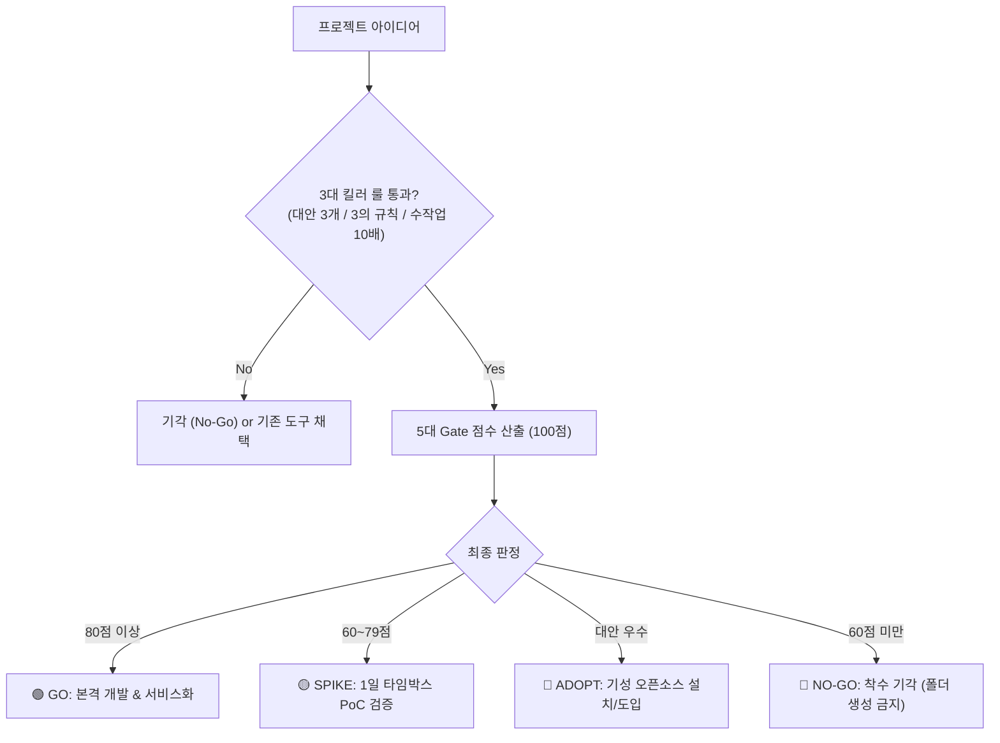

# ⚖️ worth-it

<p align="center">
  <strong>"코드를 한 줄도 작성하기 전에, 진짜 만들 가치가 있는지(Is it worth it?) 검증하라."</strong>
</p>

<p align="center">
  <a href="https://github.com/Hannoah/worth-it/blob/main/LICENSE"></a>
  
  
  
  
</p>

---

## 📌 개요 (Overview)

새 프로젝트나 자동화 아이디어가 떠올랐을 때, **바퀴의 재발명(Build vs Adopt)을 막고, 서비스화 실질 ROI를 평가**한 뒤, 오버엔지니어링 없이 **목적에 딱 맞는 초경량 아키텍처**를 처방해 주는 도구입니다. 외부 크레이트 없이 Rust 표준 라이브러리만으로 만든 **단일 바이너리 평가 엔진**입니다.

터미널에서 직접 실행하는 **CLI 도구**이자, Claude Code·Jarvis·Antigravity 같은 **AI 에이전트의 스킬(Skill)**로도 쓸 수 있습니다.

---

## 🏛️ 6대 핵심 설계 철학 (Lean Principles)

1. **군더더기 없음 (No Bloat):** 외부 크레이트 0개, 오직 Rust 표준 라이브러리(`std`)만 사용
2. **최적화 (Optimized):** LTO · Strip · `opt-level = "z"` 적용 → **334 KB 단일 실행 파일**
3. **간결함 (Concise / KISS):** 핵심 로직과 인터랙티브 UI를 최소 코드로 완결
4. **목적 적합성 (Fit for Purpose):** 요구사항에 맞는 최소 폼팩터(CLI / 에이전트 도구 / 정적 HTML) 처방
5. **불필요한 기능 구현 금지 (YAGNI):** 당장 쓰지 않는 기능과 미래 확장성 설계를 차단
6. **가볍고 확실하게 (Lightweight & Solid):** 메모리·타입 안전, 19개 단위 테스트 0.00초 통과

---

## 📦 설치 방법 (Installation)

### 방법 0. 릴리즈 바이너리 다운로드 (가장 빠름)

빌드 없이 바로 씁니다. [Releases](https://github.com/Hannoah/worth-it/releases) 페이지에서 `worth-it.exe`를 받아 실행하세요.

```powershell
# 예: v0.4.1 다운로드 후 실행
.\worth-it.exe
```

Linux / macOS는 같은 페이지의 `worth-it-<태그>-<타깃>.tar.gz`를 받아 풀면 됩니다.

| OS | 타깃 |
|---|---|
| Linux x86_64 (musl 정적 링크, 어느 배포판에서나 실행) | `x86_64-unknown-linux-musl` |
| macOS Apple Silicon | `aarch64-apple-darwin` |
| macOS Intel | `x86_64-apple-darwin` |

```bash
tar -xzf worth-it-v0.4.1-aarch64-apple-darwin.tar.gz && ./worth-it
```

### 방법 1. 소스 클론 및 빌드

```powershell
git clone https://github.com/Hannoah/worth-it.git
cd worth-it

# 릴리즈 빌드 (외부 의존성 다운로드 0초)
cargo build --release

# 생성된 단일 바이너리 확인:
# ./target/release/worth-it.exe (Windows) 또는 ./target/release/worth-it (Linux/macOS)
```

### 방법 2. 시스템 전역 명령어 등록

어느 폴더에서나 `worth-it`으로 실행하고 싶다면:

```powershell
cargo install --path .
```

### 사전 요구사항

- [Rust & Cargo](https://www.rust-lang.org/tools/install) (1.70 이상 권장, 방법 1·2만 해당)

---

## 🚀 실행 가이드 (Execution & Usage)

### 1. 🎛️ 터미널 30초 퀵 마법사 (가장 추천!)

인자 없이 실행하면 대화형 마법사가 시작됩니다. 복잡한 수치 계산 없이 **`1) 상 / 2) 중 / 3)`** 선택만으로 30초 만에 평가가 끝납니다.

```powershell
.\worth-it.exe
```

> **실시간 피드백:** 답을 고를 때마다 누적 점수와 잠정 판정(`🟢 GO 구간`, `🟡 SPIKE 구간` 등)이 바로 표시됩니다. 미선택 시 기본값은 **중(Med)**입니다.

```text
╭──────────────────────────────────────────────────────────────────╮
│ ⚖️  worth-it 판정 대시보드: smart-doc-parser                   │
├──────────────────────────────────────────────────────────────────┤
│ 🎯 최종 판정    : 🟢 GO (본격 개발 & 서비스화 승인)             │
│ 📊 가치 점수    : 92점 / 100점  ▰▰▰▰▰▰▰▰▰▰▰▰▰▰▰▰▰▰▱▱            │
│ 💡 판정 사유    : 높은 가치와 서비스화 효용이 입증되었습니다. 정식 개발 및 서비스화를 추진하세요. │
├──────────────────────────────────────────────────────────────────┤
│ 🛠️  권장 형태   : Jarvis / MCP 에이전트 내장 도구 모듈          │
│ 📦 권장 스택    : Rust 단일 바이너리 (stdin/stdout JSON-RPC) 또는 Python 표준 모듈 │
│ 📁 예상 규모    : 1개 파일 (도구 소스 1개, 100~200줄)           │
├──────────────────────────────────────────────────────────────────┤
│ 🚫 금지 기술 : 독립 웹 서버(FastAPI/Actix) 띄우기, 별도 Docker 컨테이너, 복잡한 외부 DB 연동 │
│ 🚀 다음 액션 : Jarvis custom_tools/ 디렉터리에 단일 모듈로 추가하고 audit 로깅을 연동하세요. │
╰──────────────────────────────────────────────────────────────────╯

┌────────┬──────────────────────┬──────┬──────┬────────────────────────┐
│  Gate  │ 평가 항목            │ 배점 │ 득점 │ 진척 게이지            │
├────────┼──────────────────────┼──────┼──────┼────────────────────────┤
│ Gate 1 │ 바퀴 재발명 검증     │   25 │   24 │ ▰▰▰▰▰▰▰▰▰▰▰▰  96%  │
│ Gate 2 │ 서비스화 실질 ROI    │   25 │   23 │ ▰▰▰▰▰▰▰▰▰▰▰▱  92%  │
│ Gate 3 │ 문제 고통/시급성     │   20 │   18 │ ▰▰▰▰▰▰▰▰▰▰▰▱  90%  │
│ Gate 4 │ 유지보수 TCO         │   15 │   14 │ ▰▰▰▰▰▰▰▰▰▰▰▱  93%  │
│ Gate 5 │ 전략 및 자산성       │   15 │   13 │ ▰▰▰▰▰▰▰▰▰▰▱▱  87%  │
├────────┼──────────────────────┼──────┼──────┼────────────────────────┤
│ 합  계 │ 최종 가치 점수       │  100 │   92 │ ▰▰▰▰▰▰▰▰▰▰▰▱  92%  │
└────────┴──────────────────────┴──────┴──────┴────────────────────────┘
```

### 2. 🌐 인터랙티브 HTML 대시보드 내보내기 (`--html`)

브라우저에서 바로 열어보는 **독립형 다크 테마 대시보드**를 생성합니다.

```powershell
.\worth-it.exe --name "smart-doc" --scores 24 23 18 14 13 --type agent_tool --html dashboard.html
```

- **Zero-Network:** CDN·인터넷 연결 없이 동작하는 100% 오프라인 HTML
- **인라인 SVG 원형 게이지 차트 & 린 체크리스트:** 팀 공유·보고용에 최적화
- **📋 원클릭 마크다운 복사 버튼** 내장

### 3. 📄 Markdown / JSON 리포트 생성 (CLI 모드)

CI 파이프라인이나 스크립트 자동화에 연동할 때 사용합니다.

```powershell
# 화면에 터미널 카드와 게이지 표 출력
.\worth-it.exe --name "data-sync" --scores 22 20 18 14 12 --type agent_tool

# Markdown 파일로 저장 (-o)
.\worth-it.exe --name "data-sync" --scores 22 20 18 14 12 --type agent_tool -o report.md

# 머신 리더블 JSON 출력 (Jarvis/자동화 파이프라인 연동, -o와 함께 쓰면 JSON 저장)
.\worth-it.exe --name "data-sync" --scores 22 20 18 14 12 --type agent_tool --json
```

### 4. 📝 기획 검증 템플릿 생성 (`--init`)

새 프로젝트 폴더에서 오프라인 수기 작성용 체크리스트(`WORTH_IT.md`)를 즉시 생성합니다.

```powershell
.\worth-it.exe --init [파일명.md]

# CI 등 비대화형 환경에서는 확인 없이 덮어쓰기
.\worth-it.exe --init --force
```

### 종료 코드

- `0`: 정상 종료
- `2`: 사용법 오류 (점수 누락, 알 수 없는 옵션·유형 등)

---

## 🚦 5대 Gate 평가 모델 (100점 만점)



| Gate | 평가 항목 | 배점 | 핵심 검증 질문 |
|:---:|---|:---:|---|
| **Gate 1** | **바퀴 재발명 검증** | **25점** | **시중에 더 좋은 대안이 있는가?**<br>우리 환경(폐쇄망/보안/특화 로직)만의 필수적 존재 이유가 있는가? |
| **Gate 2** | **서비스화 실질 ROI** | **25점** | **서비스화 시 실제 생산성이 오르는가?**<br>반복 사용 빈도가 높고 연간 시간 절감 규모가 큰가? |
| **Gate 3** | **문제의 고통/시급성** | **20점** | **없으면 업무가 마비되는 Must-have인가, 단순 Nice-to-have인가?** |
| **Gate 4** | **유지보수 TCO** | **15점** | **만들고 나서 기술 부채가 되지 않는가?** (표준 라이브러리 vs 무거운 의존성) |
| **Gate 5** | **전략 및 자산성** | **15점** | **핵심 비즈니스 및 개인 AI 에이전트(Jarvis) 역량을 강화하는가?** |

### 판정 규칙

- **🟢 GO (80점 이상):** 정식 개발 및 서비스화 승인. 단, 특정 Gate가 배점의 40% 미만이면 **SPIKE로 격하**됩니다 (총점만 높고 약점이 있는 경우의 성급한 본개발 방지).
- **🟡 SPIKE (60~79점):** 정식 개발 금지. 1일 타임박스 최소 프로토타입(PoC)으로 검증합니다.
- **🔵 ADOPT (Gate 1이 5점 이하):** 직접 개발 금지. 대안 이름을 입력했든 안 했든 기성 도구·패키지를 채택합니다.
- **🔴 NO-GO (60점 미만):** 착수 기각. 1회성 명령어로 대체합니다.

---

## 🛠️ 목적별 초경량 아키텍처 처방 매트릭스

| 프로젝트 목적 | 권장 구현 형태 (Form Factor) | 권장 스택 (Lean Stack) | 절대 금지 기술 (Anti-Bloat) |
|---|---|---|---|
| **초고속 대용량 연산 / CLI** | 단일 바이너리 CLI | Rust (`std` 중심, LTO/Strip 단일 exe) | 런타임 인터프리터, 과도한 의존 크레이트 |
| **Jarvis / MCP 에이전트 도구** | 단일 모듈 도구 / JSON-RPC | Rust 단일 바이너리 or Python 표준 모듈 | 별도 FastAPI/Actix 서버 띄우기, 별도 Docker |
| **오피스 자동화 / 파일 처리** | 단일 파일 CLI | Rust 또는 Python 표준 라이브러리 | `requirements.txt` 패키지 남발, 과도한 계층 구조 |
| **현황판 / 시각화 대시보드** | 더블클릭 실행 단일 HTML | HTML5 + Vanilla JS + 인라인 JSON 데이터 | React, Vue, Next.js, Node.js 빌드 파이프라인 |

---

## 🤖 AI 에이전트 스킬로 활용 (Agent Skill)

Claude Code, Antigravity, Jarvis 등에게 다음과 같이 요청하면 [SKILL.md](./SKILL.md) 지침에 따라 가치 검증 인터뷰와 아키텍처 처방을 대화형으로 수행합니다:

> 💬 *"새로운 도구 아이디어가 있는데 `worth-it` 스킬 기준으로 평가하고 아키텍처 처방해줘."*

---

## 🧪 테스트 실행 (Testing)

```powershell
cargo test
```

외부 크레이트 없이 19개 단위 테스트가 **0.00초** 만에 통과합니다. 린트도 깨끗합니다:

```powershell
cargo clippy --all-targets   # 경고 0개
```

---

## 📄 라이선스 (License)

이 프로젝트는 [MIT License](./LICENSE) 하에 배포됩니다.
Copyright (c) 2026 [Hannoah](https://github.com/Hannoah).
