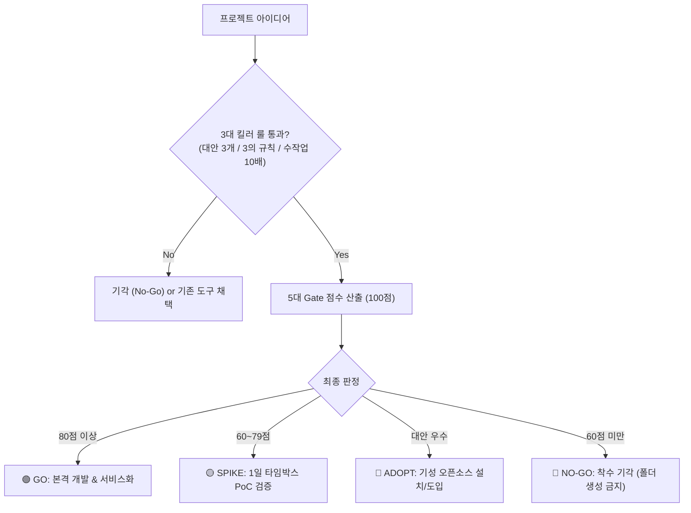

# ⚖️ worth-it

<p align="center">
  <strong>"코드를 한 줄도 작성하기 전에, 진짜 만들 가치가 있는지(Is it worth it?) 검증하라."</strong>
</p>

<p align="center">
  <a href="https://github.com/Hannoah/worth-it/blob/main/LICENSE"></a>
  
  
  
  
</p>

---

## 📌 개요 (Overview)

새로운 프로젝트나 자동화 도구 아이디어가 떠올랐을 때, **바퀴의 재발명(Build vs Adopt)을 막고, 서비스화 실질 ROI를 평가**하며, 오버엔지니어링 없이 **목적에 딱 맞는 초경량 아키텍처**를 처방해 주는 **순수 Rust(Zero-Dependency) 기반 가치평가 엔진**입니다.

사람이 직접 터미널에서 실행하는 **CLI 도구**이자, Claude Code, Jarvis, Antigravity 같은 **AI 에이전트의 스킬(Skill)**로도 활용할 수 있습니다.

---

## 🏛️ 6대 핵심 설계 철학 (Lean Principles)

1. **군더더기 없음 (No Bloat):** 외부 크레이트 0개 (Zero External Dependencies), 오직 Rust 표준 라이브러리(`std`)만 사용
2. **최적화 (Optimized):** LTO, Strip, `opt-level = "z"` 적용 → **325 KB 초경량 단일 실행 파일(`.exe`)**
3. **간결함 (Concise / KISS):** 단일 모듈 소스 코드로 핵심 로직 및 인터랙티브 UI 완결
4. **목적 적합성 (Fit for Purpose):** 요구사항에 최적화된 최소 폼팩터(CLI / 에이전트 도구 / 정적 HTML) 처방
5. **불필요한 기능 구현 금지 (YAGNI):** 지금 당장 쓰지 않는 기능과 미래 확장성 차단
6. **가볍고 확실하게 (Lightweight & Solid):** 메모리/타입 세이프티, 0.00초 10개 단위 테스트 완비

---

## 📦 설치 방법 (Installation)

### 사전 요구사항 (Prerequisites)
- [Rust & Cargo](https://www.rust-lang.org/tools/install) (1.70 이상 권장)

### 방법 1. 소스 클론 및 빌드 (권장)
```powershell
# 1. 저장소 클론
git clone https://github.com/Hannoah/worth-it.git
cd worth-it

# 2. 릴리즈 빌드 (단 4~7초 소요, 외부 의존성 다운로드 0초)
cargo build --release

# 생성된 325 KB 단일 바이너리 확인:
# ./target/release/worth-it.exe (Windows) 또는 ./target/release/worth-it (Linux/macOS)
```

### 방법 2. 시스템 전역(Global) 명령어 등록
어느 폴더에서나 `worth-it` 명령어로 바로 실행하고 싶다면 Cargo 글로벌 설치를 진행합니다:
```powershell
cargo install --path .
```
설치 후 터미널 어디서든 `worth-it`을 입력하면 즉시 실행됩니다.

---

## 🚀 실행 가이드 (Execution & Usage)

### 1. 🎛️ 터미널 30초 퀵 마법사 (가장 추천!)
대화형 마법사를 실행하면 복잡한 수치 계산 없이 **`1) 상 / 2) 중 / 3) 하`** 선택만으로 30초 만에 평가를 끝낼 수 있습니다:
```powershell
.\target\release\worth-it.exe
```
> **실시간 피드백 기능:** 질문을 고를 때마다 현재 누적 점수와 잠정 판정(`🟢 GO 구간`, `🟡 SPIKE 구간` 등)이 인라인으로 즉시 피드백됩니다.

```text
╭──────────────────────────────────────────────────────────────────╮
│  ⚖️  worth-it 판정 대시보드: smart-doc-parser                   │
├──────────────────────────────────────────────────────────────────┤
│  🎯 최종 판정 : 🟢 GO (본격 개발 & 서비스화 승인)                 │
│  📊 가치 점수 : 92점 / 100점  ▰▰▰▰▰▰▰▰▰▰▰▰▰▰▰▰▰▰▱▱             │
│  💡 판정 사유 : 높은 가치와 서비스화 효용이 입증되었습니다.     │
├──────────────────────────────────────────────────────────────────┤
│  🛠️  권장 형태 : Jarvis / MCP 에이전트 내장 도구 모듈           │
│  📦 권장 스택 : Rust 단일 바이너리 or Python 표준 모듈           │
│  📁 예상 규모 : 1개 파일 (도구 소스 1개, 100~200줄)             │
├──────────────────────────────────────────────────────────────────┤
│  🚫 금지 기술 : 독립 웹 서버(FastAPI/Actix) 금지, Docker 금지    │
│  🚀 다음 액션 : Jarvis custom_tools/ 디렉터리에 단일 모듈 추가  │
╰──────────────────────────────────────────────────────────────────╯
```

---

### 2. 🌐 인터랙티브 HTML 다크 대시보드 내보내기 (`--html`)
브라우저에서 바로 열어볼 수 있는 **세련된 독립형 다크 테마 대시보드**를 생성합니다:
```powershell
.\target\release\worth-it.exe --name "smart-doc" --scores 24 23 18 14 13 --type agent_tool --html dashboard.html
```
- **Zero-Network:** 외부 CDN/인터넷 연결이 필요 없는 100% 오프라인 동작 HTML.
- **인라인 SVG 원형 게이지 차트 & 린 체크리스트:** 팀 공유 및 보고용에 최적화.
- **📋 원클릭 마크다운 복사 버튼** 내장.

---

### 3. 📄 Markdown / JSON 리포트 생성 (CLI 모드)
CI 파이프라인이나 스크립트 자동화에 연동할 때 사용합니다:
```powershell
# 화면에 터미널 카드와 게이지 표 출력
.\target\release\worth-it.exe --name "data-sync" --scores 22 20 18 14 12 --type agent_tool

# Markdown 파일로 저장 (-o)
.\target\release\worth-it.exe --name "data-sync" --scores 22 20 18 14 12 --type agent_tool -o report.md

# 머신 리더블 JSON 출력 (Jarvis/자동화 파이프라인 연동)
.\target\release\worth-it.exe --name "data-sync" --scores 22 20 18 14 12 --type agent_tool --json
```

---

### 4. 📝 빈 기획 검증 템플릿 생성 (`--init`)
새 프로젝트 폴더에서 오프라인 수기 작성용 체크리스트(`WORTH_IT.md`)를 즉시 생성합니다:
```powershell
.\target\release\worth-it.exe --init [파일명.md]
```

---

## 🚦 5대 Gate 평가 모델 (100점 만점)



| Gate | 평가 항목 | 배점 | 핵심 검증 질문 |
|:---:|---|:---:|---|
| **Gate 1** | **바퀴 재발명 검증** | **25점** | **시중에 더 좋은 대안이 있는가?**<br>우리 환경(폐쇄망/보안/특화 로직)만의 필수적 존재 이유가 있는가? |
| **Gate 2** | **서비스화 실질 ROI** | **25점** | **서비스화 시 실제 생산성이 오르는가?**<br>반복 사용 빈도가 높고 연간 시간 절감 규모가 큰가? |
| **Gate 3** | **문제의 고통/시급성** | **20점** | **없으면 업무가 마비되는 Must-have인가, 단순 Nice-to-have인가?** |
| **Gate 4** | **유지보수 TCO** | **15점** | **만들고 나서 기술 부채가 되지 않는가?** (표준 라이브러리 vs 무거운 의존성) |
| **Gate 5** | **전략 및 자산성** | **15점** | **핵심 비즈니스 및 개인 AI 에이전트(Jarvis) 역량을 강화하는가?** |

---

## 🛠️ 목적별 초경량 아키텍처 처방 매트릭스

| 프로젝트 목적 | 권장 구현 형태 (Form Factor) | 권장 스택 (Lean Stack) | 절대 금지 기술 (Anti-Bloat) |
|---|---|---|---|
| **초고속 대용량 연산 / CLI** | 단일 바이너리 CLI | Rust (`std` 중심, LTO/Strip 단일 exe) | 런타임 인터프리터, 과도한 의존 크레이트 |
| **Jarvis / MCP 에이전트 도구** | 단일 모듈 도구 / JSON-RPC | Rust 단일 바이너리 or Python 표준 모듈 | 별도 FastAPI/Actix 서버 띄우기, 별도 Docker |
| **오피스 자동화 / 파일 처리** | 단일 파일 CLI | Rust 또는 Python 표준 라이브러리 | `requirements.txt` 패키지 남발, 과도한 계층 구조 |
| **현황판 / 시각화 대시보드** | 더블클릭 실행 단일 HTML | HTML5 + Vanilla JS + 인라인 JSON 데이터 | React, Vue, Next.js, Node.js 빌드 파이프라인 |

---

## 🤖 AI 에이전트 스킬로 활용 (Agent Skill)

Claude Code, Antigravity, Jarvis 등에게 다음과 같이 요청하면 [SKILL.md](./SKILL.md) 지침에 따라 가치 검증 인터뷰와 아키텍처 처방을 대화형으로 수행합니다:

> 💬 *"새로운 도구 아이디어가 있는데 `worth-it` 스킬 기준으로 평가하고 아키텍처 처방해줘."*

---

## 🧪 테스트 실행 (Testing)
```powershell
cargo test
```
외부 크레이트 없이 10개 단위 테스트가 **0.00초** 만에 통과합니다.

---

## 📄 라이선스 (License)

이 프로젝트는 [MIT License](./LICENSE) 하에 배포됩니다.  
Copyright (c) 2026 [Hannoah](https://github.com/Hannoah).
